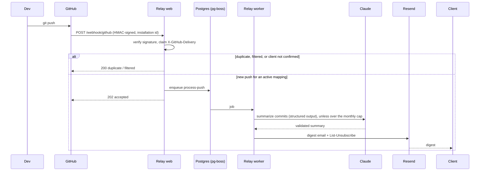

# Relay

> **Plain-English client updates from every GitHub push**

[](https://github.com/vishnumuthyalu/relay-extension/actions/workflows/ci.yml)
[](https://nodejs.org)

**Live at [relay-vishnu.fly.dev](https://relay-vishnu.fly.dev/dashboard).** [Install the GitHub App](https://github.com/apps/relay-digests), then add `https://relay-vishnu.fly.dev/mcp` to your MCP client, find **Relay** in the [MCP Registry](https://registry.modelcontextprotocol.io), or install the extension from the VS Code Marketplace or Open VSX.

Relay is a GitHub App for freelancers and agencies. Install it on your repositories, map each one to a client, and every push to the main branch becomes a short, jargon-free email summary written by Claude. Clients confirm by email before anything is sent, and every digest has a one-click unsubscribe.

## How it works



- **GitHub App**: one install connects any number of repositories, and no personal access tokens are needed ([ADR 002](docs/adr/002-github-app-over-pat.md)).
- **Multi-tenant**: every row belongs to an installation, users are authorized by the installations GitHub says they can access, and uninstalling deletes that tenant's data.
- **Postgres + pg-boss**: the webhook replies 202 immediately, and a separate worker sends digests with retries and backoff ([ADR 003](docs/adr/003-postgres-and-pg-boss.md)).
- **Consent built in**: double opt-in confirmation, signed one-click unsubscribe (RFC 8058), and confirm/unsubscribe pages that only change state on POST.
- **Cost controls**: per-installation monthly cap on Claude-written digests (plain digests past it), token usage tracking, and a `CLAUDE_ENABLED` kill switch.
- **Spec-first**: OpenAPI 3.1 and JSON Schema contracts enforced at runtime and in CI.
- **Remote MCP server with OAuth 2.1**: add one URL to Claude Code, Claude Desktop, VS Code or Cursor, sign in with GitHub, and manage Relay by chatting ([docs/mcp.md](docs/mcp.md), [ADR 004](docs/adr/004-mcp-as-cross-ide-surface.md), [ADR 005](docs/adr/005-separate-authorization-server.md)).
- **Dashboard**: a small server-rendered UI at `/dashboard` for people who don't use MCP.
- **Richer summaries (opt-in)**: merged PR descriptions from GitHub, and issue details from the tenant's ticket tracker through Anthropic's MCP connector, with read-only tool allowlists and fallbacks ([docs/summaries.md](docs/summaries.md)).

## Running locally

Prerequisites: Node.js 22.12+, Docker (for Postgres), a [GitHub App](docs/github-app.md), an Anthropic API key and a Resend API key.

```bash
git clone https://github.com/vishnumuthyalu/relay-extension.git
cd relay-extension
npm install
cp .env.example .env          # fill in the values; see docs/github-app.md
docker compose up -d db       # Postgres on localhost:5432 (dev + test databases)
npm run migrate
npm run dev                   # web process on :3000
npm run dev:worker            # worker process, in a second terminal
```

GitHub must reach your machine for webhooks and sign-in, so run a tunnel (`ngrok http 3000`) and use its URL as `PUBLIC_URL` and in the app settings.

Then:

1. Open `PUBLIC_URL/install` and install the app on a repository.
2. Open `PUBLIC_URL/dashboard` and sign in with GitHub.
3. Map the repository to a client in the dashboard, with the API (below) or with the MCP tools. The client receives a confirmation email.
4. After the client confirms, push to the default branch, or run `node simulate-webhook.js`.

To run everything in containers instead: `docker compose up --build`.

## Deploying

One image, two processes (`web`, `worker`), one Postgres. The hosted instance runs on Fly.io (one web and one worker machine) with Supabase Postgres; migrations run as Fly's release command before each deploy. See [docs/deploy.md](docs/deploy.md). Tags drive releases: `v*` deploys the backend and updates the MCP Registry entry, and `ext-v*` publishes the VS Code extension.

## Configuration

All settings are environment variables; [`.env.example`](.env.example) lists and explains each one. The web and worker processes refuse to start if a required value is missing.

| Variable | Required | Purpose |
|----------|----------|---------|
| `DATABASE_URL` | Yes | Postgres connection string |
| `PUBLIC_URL` | Yes | Public base URL (webhooks, sign-in callback, email links) |
| `SESSION_SECRET` | Yes | 32+ random characters; signs sessions and email links |
| `GITHUB_APP_SLUG`, `GITHUB_CLIENT_ID`, `GITHUB_CLIENT_SECRET`, `GITHUB_WEBHOOK_SECRET` | Yes | From the GitHub App |
| `ANTHROPIC_API_KEY` | Unless `CLAUDE_ENABLED=false` | Claude API key |
| `RESEND_API_KEY`, `FROM_EMAIL` | Yes | Email delivery (verify your sending domain in Resend) |
| `ANTHROPIC_MODEL` | No | Default `claude-haiku-4-5` |
| `DIGEST_MONTHLY_CAP` | No | Claude-written digests per installation per month, default 100 |
| `CLAUDE_ENABLED` | No | `false` sends plain digests for everyone |
| `GITHUB_APP_ID`, `GITHUB_APP_PRIVATE_KEY` | No | Pull request context in summaries |
| `INTEGRATIONS_KEY` | No | Encrypts ticket-tracker tokens; enables tracker connections |

## API

The JSON API is described in [`spec/openapi.yaml`](spec/openapi.yaml) and validated at runtime. It uses the session cookie from **Sign in with GitHub**.

| Method | Path | Purpose |
|--------|------|---------|
| `GET` | `/api/me` | You and the installations you can manage |
| `GET` | `/api/installations/{id}/mappings` | Client mappings with status (`pending`, `active`, `unsubscribed`) |
| `PUT` | `/api/installations/{id}/mappings/{owner}/{repo}` | Create or update a mapping; sends the confirmation email |
| `DELETE` | `/api/installations/{id}/mappings/{owner}/{repo}` | Stop digests for a repository |
| `POST` | `/api/installations/{id}/mappings/{owner}/{repo}/test` | Send a sample digest to a confirmed client |
| `GET` | `/api/installations/{id}/digests` | Digest history |
| `GET` | `/api/installations/{id}/usage` | This month's usage against the cap |

Other routes: `POST /webhook/github` (GitHub App deliveries), `/mcp` (remote MCP), `/oauth/*` and `/.well-known/*` (OAuth for MCP clients), `/dashboard`, `/auth/login`, `/auth/callback`, `POST /auth/logout`, `/install`, `/confirm`, `/unsubscribe`, `/privacy`, `/health`, `/ready`.

## MCP server

Remote: add `https://relay-vishnu.fly.dev/mcp` to your MCP client (or `https://<host>/mcp` for your own deployment). For example:

```bash
claude mcp add --transport http relay https://relay-vishnu.fly.dev/mcp
```

Local, against your own database:

```bash
RELAY_INSTALLATION_ID=12345678 npm run mcp   # stdio server for one installation
npm run mcp:inspect                          # open it in the MCP Inspector
```

Client setup is in [`docs/mcp.md`](docs/mcp.md), and the tool contract is in [`spec/mcp-tools.md`](spec/mcp-tools.md).

## Testing

Tests run against a real Postgres: each test file gets its own schema, so suites run in parallel. `docker compose up -d db` creates the `relay_test` database.

```bash
npm test
npm run lint
npx @stoplight/spectral-cli lint spec/openapi.yaml --ruleset .spectral.yaml
```

CI runs the same steps on Node 22 and 24 with a Postgres service container, and fails if coverage drops (`npm run test:coverage`).

## Project structure

```
relay-extension/
├── server.js                 # Web process: webhooks, sign-in, API, email link pages
├── worker.js                 # Worker process: sends digests from the queue
├── lib/
│   ├── config.js             # Env validation
│   ├── db/                   # Postgres pool, migrations runner, tenant-scoped queries
│   ├── jobs/process-push.js  # One delivery: caps, Claude or fallback, email, records
│   ├── queue.js              # pg-boss setup
│   ├── service.js            # Per-installation operations shared by API and MCP
│   ├── pipeline.js           # Summarize + email
│   ├── claude.js             # Claude structured outputs + schema validation
│   ├── email.js              # Email HTML, unsubscribe headers, Resend
│   ├── links.js              # Signed confirm/unsubscribe links
│   ├── github.js             # GitHub OAuth (Sign in with GitHub)
│   ├── oauth/                # MCP authorization server: clients, tokens, JWT
│   ├── context/              # Optional PR and ticket context for summaries
│   ├── github-app.js         # GitHub App JWT and installation tokens
│   ├── crypto-box.js         # AES-256-GCM for stored tracker tokens
│   ├── html.js, csrf.js      # Server-rendered pages and form protection
│   ├── security.js           # Webhook HMAC verification
│   └── retry.js              # Retry with backoff for Claude and Resend
├── routes/                   # webhook, mcp, oauth, auth, dashboard, api, email links
├── migrations/               # Numbered SQL migrations
├── mcp/                      # MCP server, tools, resources, stdio entrypoint
├── spec/                     # OpenAPI, JSON Schemas, webhook and MCP contracts
├── tests/                    # Jest suites + helpers (per-file Postgres schema)
├── extension/                # VS Code extension: registers the remote MCP server
├── server.json               # MCP Registry entry
├── fly.toml                  # Fly.io deployment (web + worker, migrations on release)
├── docs/                     # GitHub App, MCP, summaries, deployment, ADRs, sequence diagram
├── docker-compose.yml
└── Dockerfile
```

## Security

- Webhooks are verified with HMAC-SHA256 (constant-time) before anything else reads the body.
- Delivery IDs are claimed atomically, so duplicates and redeliveries never send twice.
- Sessions are signed `httpOnly` cookies with `SameSite=Lax`. The JSON API only accepts JSON bodies, which blocks cross-site form posts.
- Tenant data is always queried by installation, and other tenants' installations return 404.
- Email links are HMAC-signed and bound to the current address. Changing a client's email invalidates old links.
- Everything rendered into email or pages is HTML-escaped. Commit text is passed to Claude as untrusted data, and replies are schema-validated.
- No GitHub tokens are stored.
- MCP access tokens are bound to `PUBLIC_URL/mcp` (RFC 8707). PKCE is mandatory, authorization codes are single-use, refresh tokens rotate, and both are stored only as hashes. The `/mcp` endpoint checks the Host header against DNS rebinding.

## License

MIT
