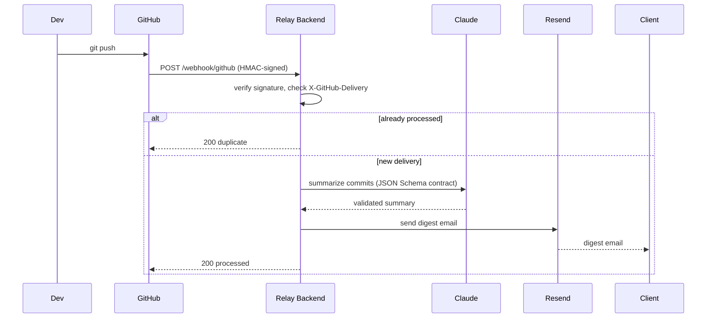

# Relay Extension

> **Automated client progress updates from GitHub pushes**

[](https://github.com/YOUR_USERNAME/relay-extension/actions/workflows/ci.yml)
[](https://nodejs.org)

Relay is a GitHub webhook-powered system that automatically generates non-technical email summaries of code changes and sends them to clients. Every time you push code, Claude AI summarizes the commits and Relay emails a digestible update to your configured client.

## 🎯 Overview

When developers push code to GitHub:
1. **GitHub** sends a webhook to your Relay backend
2. **Relay** verifies the webhook signature and checks for duplicates
3. **Claude AI** generates a client-friendly summary of the changes
4. **Resend** delivers the email to your mapped client
5. Your client stays informed without technical jargon

This project consists of two parts:
- **Backend Server**: Express.js webhook receiver with Claude integration
- **VS Code Extension**: One-command setup for webhook registration and client mapping

## ✨ Features

- ✅ **Secure webhook handling** with HMAC signature verification
- ✅ **Duplicate detection** via idempotency tracking
- ✅ **AI-powered summaries** using Claude's API with JSON schema validation
- ✅ **Branch filtering** (e.g., only notify on `main` branch pushes)
- ✅ **Automatic retry logic** for API failures (Claude, Resend)
- ✅ **Rate limiting & security headers** (Helmet, Express Rate Limit)
- ✅ **OpenAPI contract validation** at runtime
- ✅ **VS Code extension** for zero-friction setup
- ✅ **Docker support** for easy deployment
- ✅ **Comprehensive test suite** (Jest, contract testing)

## 🏗️ Architecture



## 📋 Prerequisites

- **Node.js** 22+ (for built-in SQLite support)
- **GitHub Personal Access Token** with `admin:repo_hook` scope
- **Anthropic API Key** (Claude access)
- **Resend API Key** (email delivery)
- **A publicly accessible URL** for webhook delivery (local testing: ngrok, localtunnel, etc.)

## 🚀 Installation

### 1. Clone the Repository

```bash
git clone <your-repo-url>
cd relay-extension
```

### 2. Install Dependencies

```bash
npm install
```

### 3. Environment Configuration

Create a `.env` file in the project root:

```env
PORT=3000
GITHUB_WEBHOOK_SECRET=your-random-secret-here
ANTHROPIC_API_KEY=sk-ant-api03-...
RESEND_API_KEY=re_...
FROM_EMAIL=your-verified@domain.com
CONFIG_API_KEY=another-random-secret
ONLY_BRANCH=main
```

**Environment Variables:**

| Variable | Description | Required |
|----------|-------------|----------|
| `PORT` | Server port | No (default: 3000) |
| `GITHUB_WEBHOOK_SECRET` | Shared secret for webhook HMAC | **Yes** |
| `ANTHROPIC_API_KEY` | Claude API key | **Yes** |
| `RESEND_API_KEY` | Resend API key | **Yes** |
| `FROM_EMAIL` | Verified sender email (Resend) | **Yes** |
| `CONFIG_API_KEY` | Secret for `/config` and `/test` endpoints | **Yes** |
| `ONLY_BRANCH` | Only process pushes to this branch (e.g., `main`) | No |
| `ANTHROPIC_MODEL` | Claude model ID | No (default: `claude-sonnet-4-5`) |

### 4. Start the Server

```bash
# Development (auto-restart on changes)
npm run dev

# Production
npm start
```

The server will be available at `http://localhost:3000`.

## 🔧 Configuration

### Backend Setup

#### 1. Expose Your Backend (Development)

For local testing, expose your server using a tunnel service:

```bash
# Using ngrok
ngrok http 3000

# Using localtunnel
npx localtunnel --port 3000
```

Copy the public URL (e.g., `https://abc123.ngrok.io`).

#### 2. Register GitHub Webhook

You can register the webhook either via:
- **VS Code Extension** (recommended) - see below
- **Manually** via GitHub UI (Settings → Webhooks → Add webhook)
  - Payload URL: `https://your-url.com/webhook/github`
  - Content type: `application/json`
  - Secret: Your `GITHUB_WEBHOOK_SECRET`
  - Events: Just the `push` event

#### 3. Map Repository to Client

Use the `/config` endpoint:

```bash
curl -X POST http://localhost:3000/config \
  -H "Content-Type: application/json" \
  -H "X-Config-Key: your-CONFIG_API_KEY" \
  -d '{
    "repo": "owner/repo-name",
    "clientEmail": "client@example.com",
    "clientName": "Client Name"
  }'
```

### VS Code Extension Setup (In Development)

> **Note**: The extension is currently tested via the Extension Development Host and not yet packaged as a `.vsix` file.

#### Running the Extension

1. **Open the extension folder in VS Code:**
   ```bash
   cd extension
   code .
   ```

2. **Install extension dependencies:**
   ```bash
   npm install
   ```

3. **Compile TypeScript:**
   ```bash
   npm run compile
   # Or watch mode:
   npm run watch
   ```

4. **Launch Extension Development Host:**
   - Press `F5` in VS Code
   - Or: Run → Start Debugging
   - This opens a new VS Code window with the extension loaded

#### Using the Extension

Once running in the Extension Development Host:

1. **Set Backend URL:**
   - Open VS Code Settings (Ctrl+, or Cmd+,)
   - Search for "Relay"
   - Set `relay.backendUrl` to your backend URL (e.g., `https://abc123.ngrok.io`)

2. **Register GitHub Webhook:**
   - Open Command Palette (Ctrl+Shift+P / Cmd+Shift+P)
   - Run: `Relay: Register GitHub Webhook`
   - Enter your GitHub Personal Access Token (stored securely in VS Code's SecretStorage)
   - Enter your `GITHUB_WEBHOOK_SECRET`

3. **Map Repository to Client:**
   - Open Command Palette
   - Run: `Relay: Map This Repo to a Client`
   - Enter your `CONFIG_API_KEY`
   - Enter client email and name

4. **Send Test Email:**
   - Open Command Palette
   - Run: `Relay: Send Test Digest`
   - Verifies the complete pipeline

## 📡 API Endpoints

### `GET /health`
Health check endpoint.

**Response:**
```json
{ "status": "ok" }
```

### `POST /webhook/github`
Receives GitHub push webhooks.

**Headers:**
- `X-Hub-Signature-256`: HMAC signature
- `X-GitHub-Event`: Event type (must be `push`)
- `X-GitHub-Delivery`: UUID for idempotency

**Response:**
```json
{ "status": "processed" | "duplicate" | "filtered" }
```

### `POST /config`
Map a repository to a client.

**Headers:**
- `X-Config-Key`: Your `CONFIG_API_KEY`

**Body:**
```json
{
  "repo": "owner/repo-name",
  "clientEmail": "client@example.com",
  "clientName": "Client Name"
}
```

### `POST /test`
Send a test email for a repository.

**Headers:**
- `X-Config-Key`: Your `CONFIG_API_KEY`

**Body:**
```json
{
  "repo": "owner/repo-name"
}
```

## 🧪 Testing

### Run Test Suite

```bash
npm test
```

**Test Coverage:**
- **Contract tests**: Validates OpenAPI spec compliance
- **Security tests**: HMAC verification, timing-safe comparisons
- **Claude integration**: Schema validation, retry logic
- **Unit tests**: Database operations, email rendering

### Manual Testing

1. **Simulate a webhook locally:**
   ```bash
   node simulate-webhook.js
   ```

2. **Test email delivery:**
   ```bash
   curl -X POST http://localhost:3000/test \
     -H "Content-Type: application/json" \
     -H "X-Config-Key: your-CONFIG_API_KEY" \
     -d '{"repo": "owner/repo-name"}'
   ```

## 🐳 Docker Deployment

### Build Image

```bash
docker build -t relay-extension .
```

### Run Container

```bash
docker run -d \
  -p 3000:3000 \
  -v $(pwd)/data:/app/data \
  -e GITHUB_WEBHOOK_SECRET=your-secret \
  -e ANTHROPIC_API_KEY=sk-ant-... \
  -e RESEND_API_KEY=re_... \
  -e FROM_EMAIL=noreply@yourdomain.com \
  -e CONFIG_API_KEY=your-config-key \
  -e ONLY_BRANCH=main \
  --name relay-backend \
  relay-extension
```

### Docker Compose (Recommended)

Create `docker-compose.yml`:

```yaml
version: '3.8'
services:
  relay:
    build: .
    ports:
      - "3000:3000"
    volumes:
      - ./data:/app/data
    env_file:
      - .env
    restart: unless-stopped
```

Run:
```bash
docker-compose up -d
```

## 🔒 Security Considerations

- ✅ **HMAC Signature Verification**: All webhooks are cryptographically verified
- ✅ **Timing-Safe Comparisons**: Prevents timing attacks on secrets
- ✅ **Rate Limiting**: `/config` and `/test` endpoints are rate-limited
- ✅ **Helmet.js**: Security headers (CSP, HSTS, etc.)
- ✅ **Input Validation**: OpenAPI validator enforces request schemas
- ✅ **HTML Escaping**: All user-generated content is escaped in emails
- ✅ **Secret Storage**: VS Code extension uses encrypted SecretStorage
- ✅ **No Logs of Secrets**: API keys never appear in logs

**Important**: Never commit your `.env` file or expose API keys in version control.

## 📁 Project Structure

```
relay-extension/
├── server.js              # Main Express server
├── lib/
│   ├── claude.js          # Claude API integration + schema validation
│   ├── db.js              # SQLite database operations
│   ├── email.js           # Email rendering & Resend integration
│   ├── retry.js           # Exponential backoff retry logic
│   └── security.js        # HMAC verification & auth middleware
├── extension/
│   ├── src/
│   │   └── extension.ts   # VS Code extension commands
│   └── package.json       # Extension manifest
├── spec/
│   ├── openapi.yaml       # API contract (enforced at runtime)
│   ├── summary.schema.json # Claude output schema
│   └── webhook-contract.md # GitHub webhook specification
├── tests/
│   ├── claude.test.js
│   ├── contract.test.js
│   └── security.test.js
├── data/                  # SQLite database (auto-created)
├── docs/
│   ├── sequence.md        # Mermaid sequence diagram
│   └── adr/
│       └── 001-webhook-vs-git-hook.md
├── Dockerfile
└── package.json
```

## 🛠️ Development

### Linting

```bash
npm run lint
```

### Watch Mode

```bash
npm run dev  # Backend auto-restarts on changes

# Extension (in extension/ folder)
npm run watch  # TypeScript recompiles on changes
```

### Adding a New Feature

1. Update `spec/openapi.yaml` for new endpoints
2. Implement in `server.js` or modular `lib/` files
3. Add tests in `tests/`
4. Update this README

## 📦 Future Work: Packaging the Extension

Once you're ready to distribute the VS Code extension:

### 1. Install vsce

```bash
npm install -g @vscode/vsce
```

### 2. Update Extension Metadata

In `extension/package.json`:
- Set `publisher` to your VS Code Marketplace publisher ID
- Update `version`, `description`, `repository`, etc.
- Add an `icon.png` (128x128) to the extension folder

### 3. Package Extension

```bash
cd extension
vsce package
```

This creates a `.vsix` file (e.g., `relay-setup-0.1.0.vsix`).

### 4. Install Locally

```bash
code --install-extension relay-setup-0.1.0.vsix
```

### 5. Publish to Marketplace (Optional)

```bash
vsce publish
```

Or manually upload the `.vsix` to the [VS Code Marketplace](https://marketplace.visualstudio.com/manage).

## 📚 Documentation

- [OpenAPI Specification](spec/openapi.yaml)
- [Webhook Contract](spec/webhook-contract.md)
- [Architecture Decision Records](docs/adr/)
- [Sequence Diagram](docs/sequence.md)

## 🙏 Acknowledgments

- [Anthropic Claude](https://www.anthropic.com/) for AI-powered summaries
- [Resend](https://resend.com/) for reliable email delivery
- [Express OpenAPI Validator](https://github.com/cdimascio/express-openapi-validator) for runtime contract enforcement

---

**Built with ❤️ for keeping clients in the loop without the technical overhead.**