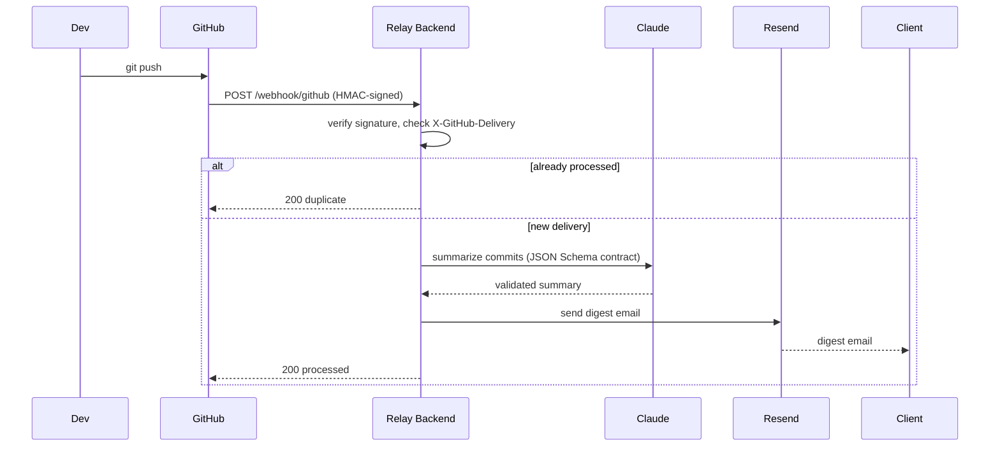

# Sequence diagram

Matches the contracts in `spec/openapi.yaml` and `spec/webhook-contract.md`
(Part 2): same five system actors — GitHub, the relay backend, Claude,
Resend, and the client — in the same order of operations. `Dev` is shown
only as the trigger that kicks the flow off; it isn't one of the five
contracted actors.

