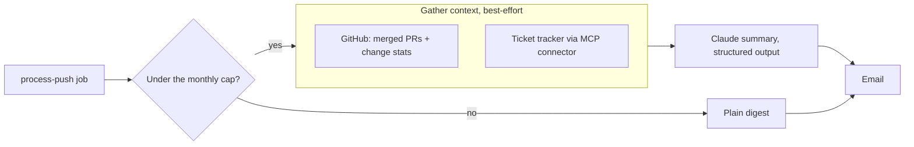

# Richer summaries

By default, Relay summarizes the first line of each commit message. Two
optional sources give Claude more to work with. Both are off until a tenant
turns them on in the dashboard (**Summaries** section), and both are
best-effort: if a source fails or times out, the digest goes out with what
Relay has.

## 1. Pull request context

When it's on, the worker reads, as the GitHub App installation:

- the merged pull requests that contain the push's head commit (title and
  the first 800 characters of the description), and
- one compare call for the whole push (files changed, lines added and
  removed, the most-changed files).

Server setup:

- Give the app **Pull requests: Read-only** (existing installations get a
  prompt to approve it), and generate a private key on the app page.
- Set `GITHUB_APP_ID` and `GITHUB_APP_PRIVATE_KEY`. Keep the key's line
  breaks as `\n` if your host only supports single-line values.

## 2. Ticket context through MCP

If commit messages or the branch name mention issues like `ENG-142`, Relay
can ask the tenant's ticket tracker about them. Many trackers (Linear,
Atlassian and others) publish a remote MCP server. Relay hands that server
to Claude through Anthropic's **MCP connector**: the Messages API's
`mcp_servers` parameter plus an `mcp_toolset` with the
`mcp-client-2025-11-20` beta header. Claude then calls the tracker's tools
itself.

This is a separate call made before the summary. It returns short notes,
which go into the summary prompt as background, so the summary keeps its
structured-output guarantee.

Tenant setup (dashboard → Summaries):

| Field | What to enter |
|-------|---------------|
| Name | e.g. `Linear` |
| MCP server URL | The tracker's remote MCP endpoint, from its docs |
| Access token | A token the MCP server accepts as `Authorization: Bearer` (check the tracker's MCP docs) |
| Read-only tools | Tool names Claude may call, from the tracker's MCP tool list, e.g. `get_issue` |

Server setup: set `INTEGRATIONS_KEY` (`openssl rand -base64 32`). Tokens are
stored AES-256-GCM encrypted with it and never shown again.

## Guardrails

- **Allowlist only.** The toolset is `default_config: { enabled: false }`,
  plus only the tools the tenant listed, so Claude can't create, edit or
  comment in the tracker even if the token would allow it.
- **Untrusted input.** Commit text, PR descriptions and tool results can
  contain prompt-injection attempts. Both system prompts say so, background
  is wrapped in a `<context>` block that it can't close early, the summary
  is schema-validated, and everything in the email is HTML-escaped.
- **Bounded.** At most 10 ticket keys, 800 output tokens, 30-second timeout
  and 4,000 characters of context per push.
- **Counted.** The ticket lookup's tokens go into the installation's monthly
  usage. Over the cap, no context is gathered at all.
- **SSRF.** Tracker URLs must be HTTPS on a public hostname (no IP literals,
  `localhost`, `.local` or `.internal`). Resolve and check addresses too
  before a public launch.